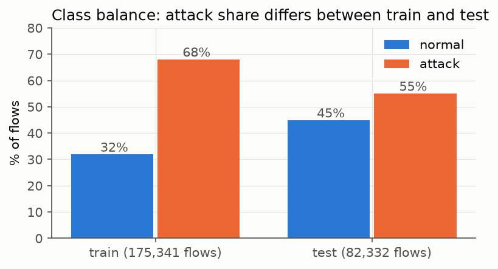
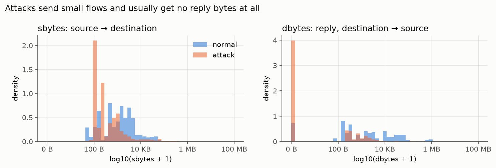
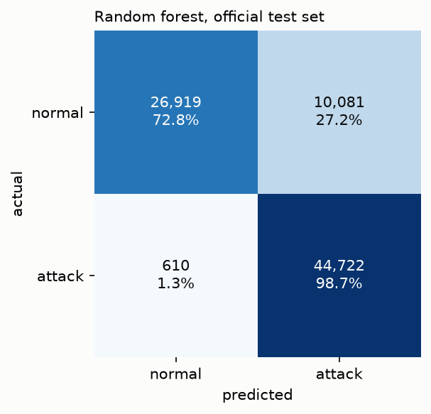
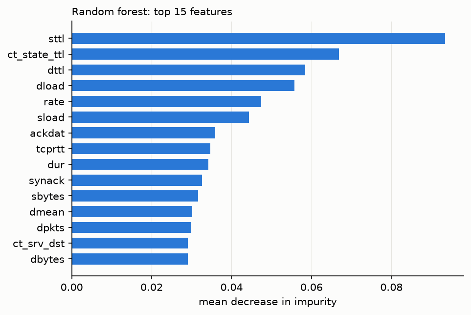

# Network Intrusion Detection on UNSW-NB15

Classifying network flows as **normal** or **attack** using the
[UNSW-NB15](https://research.unsw.edu.au/projects/unsw-nb15-dataset) dataset,
comparing a scikit-learn random forest against a PyTorch feed-forward network.

> 🚧 Work in progress. See [PROGRESS.md](PROGRESS.md) for current status and
> [docs/LEARNING_LOG.md](docs/LEARNING_LOG.md) for design decisions and a glossary.

## Goals

- Binary classification (normal vs. attack) evaluated on the **official test split**
- Honest comparison of a tree ensemble vs. a neural network on tabular data
- Metrics that matter for imbalanced security data: precision, recall, F1, confusion matrix
- Stretch: multi-class by attack category; FastAPI prediction service in Docker

## Dataset

UNSW-NB15 was created by the Cyber Range Lab at UNSW Canberra. Each row is a
network flow described by features such as protocol, service, connection state,
bytes, packets, and duration.

The data is **not** included in this repo. Download the two partitioned CSVs and
place them in `data/raw/` without renaming them:

```
data/raw/UNSW_NB15_training-set.csv
data/raw/UNSW_NB15_testing-set.csv
```

> **Note on file names:** in the distributed copies, the names are swapped relative to
> the paper. The official training split (175,341 flows) is in `UNSW_NB15_testing-set.csv`,
> and the official testing split (82,332 flows) is in `UNSW_NB15_training-set.csv`.
> [`src/nids/config.py`](src/nids/config.py) maps them correctly, and the loader checks
> row counts so a mix-up fails loudly.

**Citation:** N. Moustafa and J. Slay, "UNSW-NB15: a comprehensive data set for network
intrusion detection systems (UNSW-NB15 network data set)," *Military Communications and
Information Systems Conference (MilCIS)*, 2015.

## Data exploration highlights

Full analysis: [notebooks/01_data_exploration.ipynb](notebooks/01_data_exploration.ipynb)

| Finding | Why it matters |
|---|---|
| Attacks are the **majority**: 68.1% of train, 55.1% of test | Always predicting "attack" scores 55.1% test accuracy, so accuracy alone is misleading |
| Nine attack families from 40,000 (Generic) down to 130 (Worms) flows | Rare classes will be hard in multi-class |
| Median attack flow: 2 packets out, **0 back**, ~9 µs | Scans and floods rarely get a reply; `state=INT` (no reply) is 93% attack |
| Source TTL is the strongest single signal (corr 0.69) | A lab artifact: TTL identifies the attacker machines. Tested with an ablation in Phase 4 |
| 42.4% of training rows repeat another row's features; 10.4% of test rows also appear in train | Documented, not hidden; slightly inflates test scores |




## Preprocessing

Walkthrough: [notebooks/02_preprocessing.ipynb](notebooks/02_preprocessing.ipynb) · Code: [src/nids/preprocess.py](src/nids/preprocess.py)

1. Drop `id` (row number) and `attack_cat` (encodes the label: with it, a one-question tree scores 100% on test)
2. Hold out 20% of the official training split as a stratified validation set
3. One-hot encode `proto`, `service`, `state`; categories unseen in training are ignored
4. `log1p` on 26 heavily skewed volume and timing features, then standard scaling
5. **Fit on the training part only**; validation and test are transform-only

| Split | Flows | Features | Attack share |
|---|---|---|---|
| Train | 140,272 | 192 | 68.1% |
| Validation | 35,069 | 192 | 68.1% |
| Test (official) | 82,332 | 192 | 55.1% |

## Project structure

```
data/raw/          original CSVs (git-ignored)
data/processed/    transformed data (git-ignored)
docs/              learning log: architecture decisions + glossary
notebooks/         exploration and experiments
src/nids/          reusable code: config, preprocessing, models
models/            trained model artifacts (git-ignored)
reports/figures/   plots used in this README
tests/             unit tests
```

## Setup (Windows / PowerShell)

```powershell
python -m venv .venv
.venv\Scripts\Activate.ps1
python -m pip install --upgrade pip
pip install -r requirements.txt
pip install -e .
pytest
```

`pip install -e .` makes the `nids` package importable from notebooks and scripts.

## Results

### Random forest baseline

Code: [src/nids/train_rf.py](src/nids/train_rf.py) · Run: `python -m nids.train_rf` · Metrics: [reports/metrics/rf.json](reports/metrics/rf.json)

200 trees, `max_features="sqrt"`. Leaf size and class weighting were chosen on the **validation set**,
and the test set was evaluated once. Attack is the positive class.

| | Accuracy | Precision | Recall | F1 | False-positive rate | ROC AUC |
|---|---|---|---|---|---|---|
| Always predict "attack" (test) | 55.1% | 55.1% | 100% | 0.710 | 100% | n/a |
| Random forest (validation) | n/a | 96.4% | 97.8% | 0.971 | 7.9% | n/a |
| **Random forest (test)** | **87.0%** | **81.6%** | **98.7%** | **0.893** | **27.2%** | **0.979** |
| Random forest without TTL features (test) | 86.8% | 81.5% | 98.5% | 0.892 | 27.4% | n/a |



**Reading the results honestly**

- The model **catches 98.7% of attacks** (610 missed out of 45,332).
- It also **flags 27.2% of normal flows** as attacks (10,081 false alarms). In a SOC, that's alert fatigue.
- **Validation F1 is 0.971 but test F1 is 0.893.** Validation is a random slice of the training traffic;
  the official test set is different traffic. The test number is the one that counts.
- **88% of the false alarms have source TTL 254**, the TTL most associated with attacks in training.
  Normal traffic with TTL 254 doubles from 20.1% of normal flows in train to 40.7% in test.
- **Removing the TTL columns didn't help** (F1 0.893 → 0.892, false-positive rate unchanged). The model
  likely recovers the same "which lab machine" signal from correlated features, such as TCP timing.
  That makes this a dataset limitation, not something one dropped column can fix.
- ROC AUC of 0.979 says the model *ranks* flows well. The 0.5 decision threshold was learned on traffic
  that's 68% attack, which fits test traffic (55% attack) less well.



## Model comparison

_Coming in phase 6._
